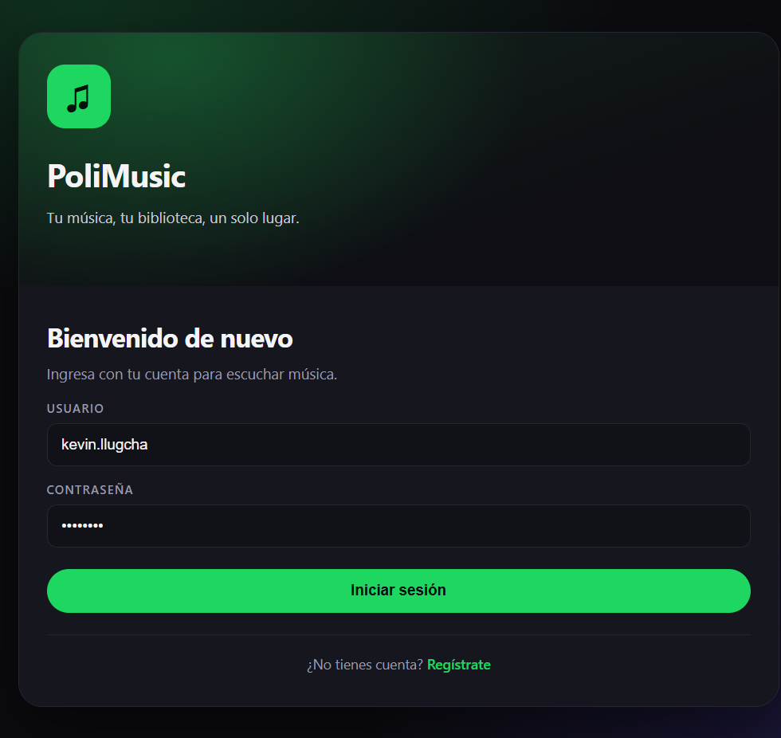
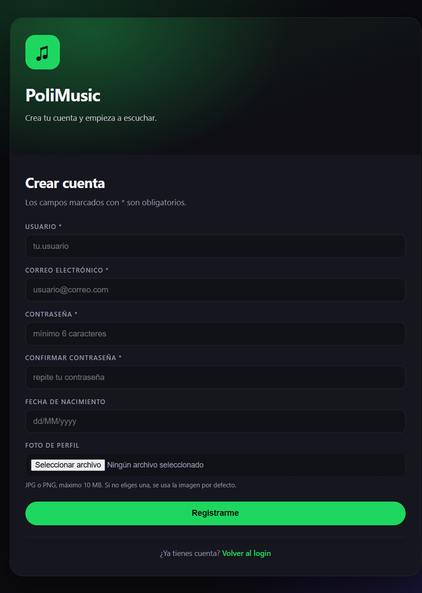
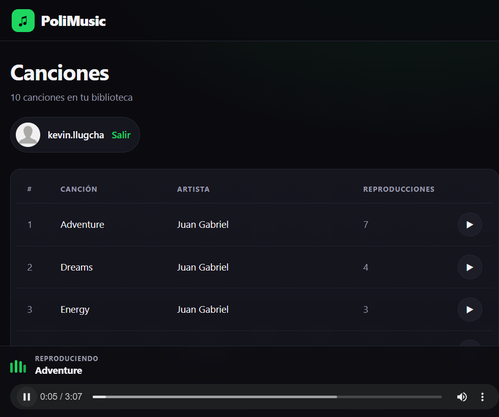
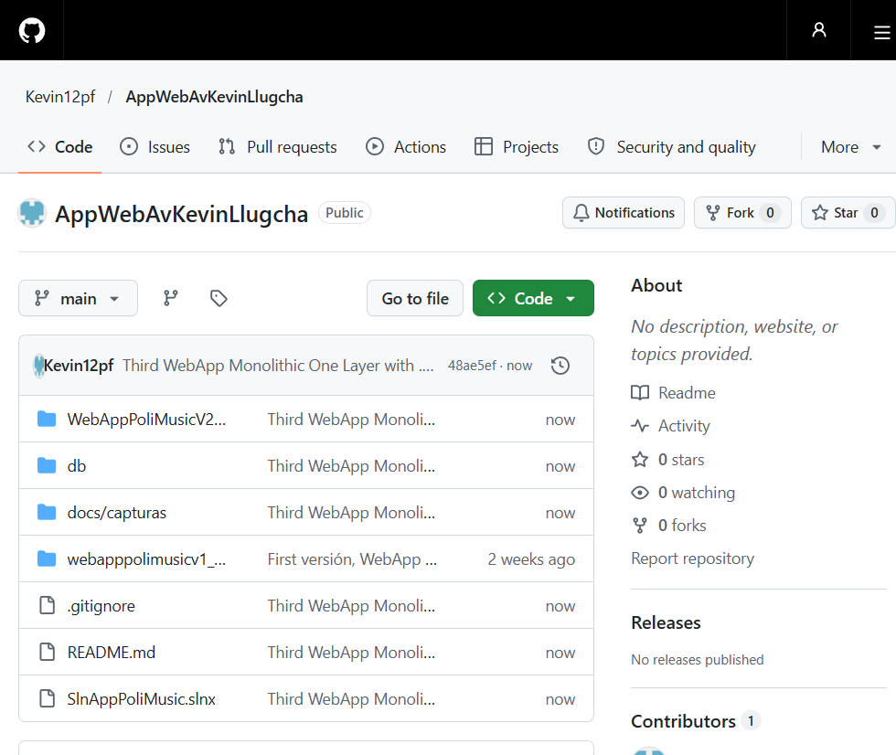

# PoliMusic · WebApp monolítica ASP.NET WebForms (.NET Framework 2.0)

**Laboratorio 03 — Aplicaciones Web Avanzadas**
Aplicación web monolítica de una sola capa construida con **ASP.NET WebForms** sobre **.NET Framework 2.0**, conectada a la base de datos **`BDD_PoliMusic`** de SQL Server.

**Repositorio GitHub:** <https://github.com/Kevin12pf/AppWebAvKevinLlugcha>

---

## 1. Funcionalidades

- Inicio de sesión con **Forms Authentication** y contraseña hasheada con SHA1 (según el laboratorio).
- Registro de usuarios con foto de perfil, validaciones y control de duplicados.
- Cierre de sesión.
- Listado de canciones con `GridView` alimentado desde SQL Server.
- Reproductor de audio HTML5 integrado: cada fila permite reproducir su canción.
- Contador de reproducciones (`PLAYS`) que se incrementa al reproducir.
- Diseño propio con tema oscuro, responsive y sin dependencias externas (CSS/JS locales).

## 2. Arquitectura

Un único proyecto web (monolítico, una capa física) con separación lógica por carpetas:

```
AppWebAvKevinLlugcha/
├─ webapppolimusicv1_asp/     (versión anterior, ASP clásico)
├─ SlnAppPoliMusic.slnx
├─ WebAppPoliMusicV2_ASPX_F2.0/
│  └─ WebAppPoliMusicV2/
│     ├─ Entities/        User.cs, Song.cs
│     ├─ Util/            Constants.cs, Hash.cs
│     ├─ DAL/             User.cs, Song.cs
│     ├─ BLL/             User.cs, Song.cs
│     ├─ Content/         site.css
│     ├─ Scripts/         site.js
│     ├─ Login.aspx       Logout.aspx   SignUp.aspx
│     ├─ Default.aspx     Song.aspx
│     ├─ FileManagement.cs
│     ├─ Web.config
│     ├─ songFiles/       userImages/   playlistImages/
│     ├─ albumImages/     artistImages/
│     └─ WebAppPoliMusicV2.csproj
├─ db/
│  ├─ seed-demo-user.sql      (normaliza contraseñas de demo)
│  └─ fix-song-paths.sql      (normaliza rutas de canciones)
├─ docs/capturas/             (evidencias)
├─ .gitignore
└─ README.md
```

> La carpeta `webapppolimusicv1_asp` corresponde a la versión anterior (ASP clásico) y se conserva en el repositorio, pero **no forma parte** de `SlnAppPoliMusic.slnx`.

## 3. Requisitos

- Visual Studio 2026 Community con la carga de trabajo **ASP.NET and web development**.
- SQL Server local con la base de datos `BDD_PoliMusic`.
- IIS Express (incluido con Visual Studio) o el servidor de desarrollo de VS.
- .NET Framework 2.0 runtime.

### Nota sobre .NET Framework 2.0

El equipo no tiene instalado el *targeting pack* de .NET Framework 2.0. Para que el proyecto compile sin instalarlo, se agregó la referencia de compilación:

```xml
<PackageReference Include="Microsoft.NETFramework.ReferenceAssemblies.net20" Version="1.0.3" />
```

Si Visual Studio muestra una advertencia indicando que el *targeting pack* no está instalado, el proyecto igualmente compila y ejecuta. Alternativamente se puede instalar el soporte de .NET Framework 2.0/3.0/3.5 desde el instalador de Visual Studio.

## 4. Base de datos

La base `BDD_PoliMusic` ya existe en la instancia local. Si se parte desde cero:

```powershell
sqlcmd -S localhost -E -C -i "C:\ruta\BDD_PoliMusic.sql"
```

Luego ejecutar los scripts de normalización incluidos:

```powershell
sqlcmd -S localhost -E -C -i db\seed-demo-user.sql
sqlcmd -S localhost -E -C -i db\fix-song-paths.sql
```

- `seed-demo-user.sql` deja las contraseñas de los usuarios de demostración en `SHA1('12345678')`, porque el login hashea antes de comparar.
- `fix-song-paths.sql` corrige las 5 filas que apuntaban a `assets/audio/` para que usen `~/songFiles/`.

### Cadena de conexión

`Web.config` usa autenticación integrada de Windows porque la instancia local está en modo solo Windows:

```xml
<add name="BDD_PoliMusicConnectionString"
     connectionString="Data Source=localhost;Initial Catalog=BDD_PoliMusic;Integrated Security=True;"
     providerName="System.Data.SqlClient" />
```

La cadena original del laboratorio (`usr_polimusic` / `Politecnica1`) queda comentada en el mismo archivo para cuando el servidor tenga habilitada la autenticación mixta.

## 5. Cómo ejecutar

### Opción A — Visual Studio 2026

1. Abrir `SlnAppPoliMusic.slnx`.
2. Clic derecho en `WebAppPoliMusicV2` → **Establecer como proyecto de inicio**.
3. Clic derecho en `Default.aspx` → **Establecer como página de inicio**.
4. Presionar **F5**.

### Opción B — MSBuild + IIS Express

```powershell
# Compilar
msbuild WebAppPoliMusicV2_ASPX_F2.0\WebAppPoliMusicV2\WebAppPoliMusicV2.csproj /restore /p:Configuration=Debug

# Ejecutar (CLR v2.0)
& "C:\Program Files\IIS Express\iisexpress.exe" `
  /path:"$PWD\WebAppPoliMusicV2_ASPX_F2.0\WebAppPoliMusicV2" `
  /port:52310 /clr:v2.0 /systray:false
```

Abrir <http://localhost:52310/Login.aspx>.

## 6. Credenciales de prueba

| Usuario | Contraseña | Tipo |
|---|---|---|
| `kevin.llugcha` | `12345678` | Administrador |
| `userNormal` | `12345678` | Normal |
| `userAdmin` | `12345678` | Administrador |
| `username1` | `12345678` | Normal |
| `kevin.demo` | `12345678` | Normal (creado en las pruebas de registro) |

El Login precarga `kevin.llugcha` / `12345678` cuando se compila en `DEBUG`.

## 7. Pruebas funcionales realizadas

| Prueba | Resultado |
|---|---|
| Login con credenciales correctas (admin) | ✅ Redirige a `Song.aspx` |
| Login con contraseña incorrecta | ✅ Muestra “Login/password incorrect, try again.” |
| Login respetando `ReturnUrl` | ✅ Redirige a `Song.aspx` |
| Registro con foto de perfil | ✅ Usuario creado y foto guardada en `userImages/` |
| Registro con usuario duplicado | ✅ Muestra “Username already registered!” |
| Validación de correo / confirmación / fecha | ✅ Mensajes en español |
| Cierre de sesión | ✅ Limpia sesión y redirige a Login |
| Acceso a `Song.aspx` sin sesión | ✅ Redirige a `Login.aspx?ReturnUrl=...` |
| `Default.aspx` | ✅ Redirige a `Song.aspx` |
| Listado de canciones desde SQL Server | ✅ 10 filas; 5 con artista asociado y todas con reproducciones |
| Reproducción de audio | ✅ `audio` reproduce el MP3 y actualiza el título |
| Incremento de `PLAYS` | ✅ Se actualiza en la base al reproducir |

## 8. Evidencias

### Login


### Registro de usuario


### Listado y reproducción de canciones


### Repositorio en GitHub


## 9. Notas y limitaciones

- El paquete de recursos original solo incluye `bensound-adventure.mp3`. Para que las 10 filas sean reproducibles se copió ese archivo con los nombres `bensound-dreams.mp3`, `bensound-energy.mp3`, `bensound-scifi.mp3` y `bensound-tomorrow.mp3`.
- Las carpetas `albumImages/` y `artistImages/` se crearon vacías porque el paquete de recursos no las incluye y las pantallas requeridas no las utilizan.
- El laboratorio pide SHA1 para las contraseñas; en un sistema real se debería usar PBKDF2/Argon2 (la clase `Hash` incluye `HashPassword` con PBKDF2, pero el flujo del laboratorio usa SHA1).
- No se implementó `DesktopAdmin.aspx`: los usuarios administradores también se redirigen a `Song.aspx`, evitando un 404.
- El código fuente está publicado en GitHub: <https://github.com/Kevin12pf/AppWebAvKevinLlugcha>.

## 10. Comandos Git

El repositorio ya está clonado y el remoto `origin` configurado. Para publicar cambios:

```powershell
git add .
git commit -m "Third WebApp Monolithic One Layer with .NET Framework 2.0"
git push origin main
```
